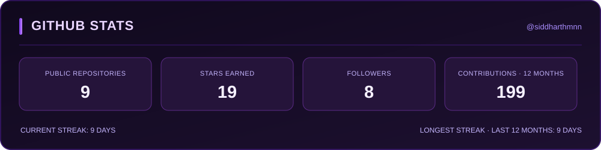
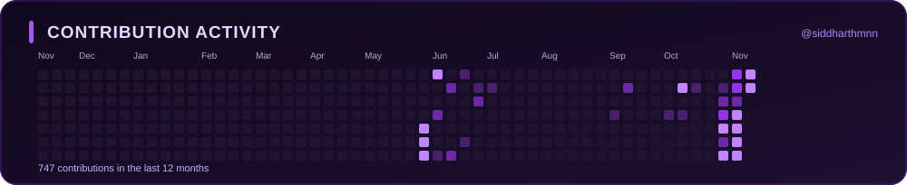

<!-- Profile README for github.com/siddharthmnn -->

  

  

  <a href="https://www.linkedin.com/in/siddharthmnn/">LinkedIn</a>
  ·
  <a href="https://github.com/siddharthmnn">GitHub</a>
  ·
  

---

## About Me

I like building things, figuring out how they work, and occasionally breaking them in the process.

Most of my time goes into software development, backend systems, Linux, databases, and networking. I enjoy coding, working with Linux, building backend applications, and understanding how systems work. I particularly like the lower-level stuff — operating systems, networking, databases, and the things that make software actually run.

I'm also heavily interested in cybersecurity, cryptography, and network security. I spend quite a bit of time on CTFs, solving challenges, and learning different attack techniques. I've also hosted CTF challenges and conducted technical workshops at college.

Outside of that, I'm interested in AI, cloud infrastructure, and distributed systems. Always up for a good technical rabbit hole.

---

## Now

### Education

**B.Tech in Computer Science and Engineering**  
PES University

### Engineering

- Building backend services and AI-powered applications.
- Worked on RAG retrieval workflows involving document chunking, BM25, ChromaDB, query processing, relevance ranking, and context augmentation.
- Implemented a BM25-based vectorless retrieval pipeline and worked with dense retrieval, embeddings, semantic search, and hybrid retrieval.
- Developed Python prototypes for retrieval systems and documented their architectures and technical workflows.

### Research

**Catena — Graph-Aware Runtime Defense Against Multi-Stage Attacks in Distributed LLM Agents**  
**IN PROGRESS** · Working on runtime defense for distributed LLM agent architectures.

**V2X & Autonomous Vehicle Networking**  
**IN PROGRESS** · Working with SUMO-based traffic simulation and V2X communication as part of the **Center for Computer Networks and Cyber Security (CCNCS), PES University**.

---

## Areas of Interest

| Category | Interests |
|---|---|
| **Systems & Programming** | Linux, C/C++, Python, Operating Systems, Systems Design |
| **Networking** | Computer Networking, Network Protocols, Distributed Systems |
| **Backend & Databases** | Backend Development, REST APIs, SQL, PostgreSQL |
| **Development Tools** | Git, GitHub, Bash, Docker, VS Code, CI/CD |
| **Cybersecurity** | Applied Cryptography, Application Security, Network Security, Vulnerability Research, Penetration Testing |
| **Cloud & Infrastructure** | AWS, Kubernetes, Kubernetes Security |
| **AI** | Generative AI, RAG Systems, LLM Applications |

---

## Technologies & Tools

**Languages**

  

**Backend & Databases**

  

**Systems & Infrastructure**

  

**AI / Retrieval:** BM25 · ChromaDB · RAG · Embeddings · Semantic Search

---

## GitHub Activity

  

  

Statistics are generated from GitHub and refreshed daily by GitHub Actions.

---

  

